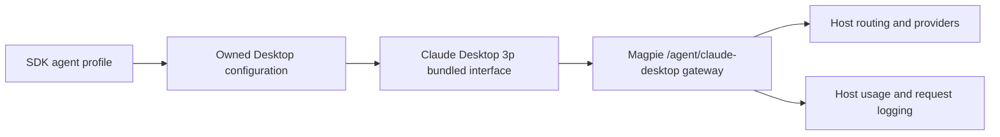

# Claude Desktop agent contract

## Scope

The package uses the public SDK AgentWiring contract, minimum API 1.5, through
a native ABI 1 module. Its module ID is `agent-claude-desktop`; its agent ID is
`claude-desktop-sdk`, with the canonical agent target `claude-desktop`.
Version 0.1.0 declares `darwin/arm64` and `darwin/amd64` only.

The module owns Desktop configuration. It registers no provider, external
backend, OAuth emulator or new HTTP endpoints. Opening and restarting Desktop
remain user actions in this configuration-only version.

The gateway URL retains the original host-owned key and the existing Desktop
path prefix. This keeps model aliases, effort tiers, reverse model routing,
authentication, accounting and logging on their established host path. It
does not change the separate Anthropic provider's URL or authorization.

## Owned configuration

All paths are relative to the macOS user's `Library/Application Support`:

| Exact path | Owned purpose |
| --- | --- |
| `Claude/claude_desktop_config.json` | Initial remembered `deploymentMode: "3p"` on explicit connect |
| `Claude-3p/claude_desktop_config.json` | Initial remembered third-party mode on explicit connect |
| `Claude-3p/configLibrary/_meta.json` | Applied profile ID and the owned entry |
| `Claude-3p/configLibrary/a363652b-0f53-4cd6-aede-cd0000000001.json` | Gateway profile |
| `Magpie SDK/agents/claude-desktop.json` | Versioned hashes of the applied profile fields |

The current Desktop reader accepts flat profile keys. The gateway profile
contains `inferenceProvider: "gateway"`, `inferenceCredentialKind: "static"`,
`inferenceGatewayBaseUrl`, `inferenceGatewayApiKey`,
`inferenceGatewayAuthScheme: "bearer"`,
`disableDeploymentModeChooser: true`, `desktopHome: "standard"` and
`isClaudeCodeForDesktopEnabled: true`.

The profile UUID belongs to this package and differs from the built-in's
profile. The host's normal SDK ownership selection must prevent both owners
from applying competing configuration. A distinct UUID alone is not an
ownership policy.

The package preserves other profiles, metadata entries, unrelated JSON fields
and changes made by the user after connection. Disconnect restores the
previous owned values only when the current values still match the package's
applied values. Missing files, malformed JSON and unknown state must be
distinguished; an unreadable document is not an empty document to overwrite.

The fifth file is a package receipt, carried by the same public SDK
configuration snapshot and checked file-change transaction as the four
Desktop files. It stores SHA256 hashes of compact JSON field values, without
duplicating plaintext credentials or the destination. It avoids adding
bookkeeping fields to Desktop's profile or exposing them as editable agent
settings. Disconnect compares against these applied hashes, not the host's
possibly changed current port or key. The host retains the original preimage
for restoration. Missing or malformed receipt data fails closed; hashes
describe ownership and do not authenticate an inference request.

The effective profile's explicit `deploymentMode: "1p"` takes precedence over
the disabled chooser in recovered Desktop 5.11492.5. Connect, inspect and sync
therefore refuse that override and invalid optional profile-mode values.
Absent, `"any"` and `"3p"` profile modes are compatible with the owned disabled
chooser and gateway configuration. The package does not overwrite or take
ownership of that optional profile field.

Remembered root mode is consulted later by Desktop and is not a second
connection invariant under this forced profile. Explicit connect writes the
two initial root mode values. Inspect accepts their later change or removal;
sync preserves those values and does not recreate deleted root files.
Desktop has a source path that removes an obsolete persisted first-party
selection. This does not imply that every launch removes stored third-party
mode. Disconnect restores an unchanged owned `"3p"` value, preserving later
user edits or removals.

Connect refuses an existing `hybridPointer` in the library metadata, because
Desktop gives it precedence over `appliedId`. Inspect and sync also refuse a
new hybrid pointer, a changed profile selection or an owned chooser,
gateway or credential conflict. These conflicts require an explicit user
choice rather than a background write reclaiming the setting. A changed host
address or key requires explicit reconnect; disconnect still restores
unchanged applied fields from the original snapshot.

Desktop may replace a plain key with an opaque `__sealed__:v1` credential.
Synchronization preserves an unknown sealed value rather than treating it as
an empty key or trying to decrypt it. Sealed data is not authorization for a
new gateway destination. Tests must cover profile/key preservation and
disconnect after both package changes and later user edits.

The package does not write Managed Preferences, patch app bundles, alter
`/etc/hosts`, install trust certificates or change Keychain state. A device
policy may override or disable the local profile; repeated file writes cannot
establish that the application accepted it.

## Desktop protocol boundary

The recovered 5.11492.5 deployment implementation selects `app://localhost`
in 3p mode. Desktop serves its own `ion-dist.asar` interface and local
bootstrap/account/settings responses. The static gateway credential source
does not require Anthropic Console OAuth or a `claude.ai` session cookie.

The often-mentioned
`/v1/environment_providers/private/organizations/{org}/environments` calls
in the reviewed source belong to cloud environment selection and bridge
deregistration. They are not the local gateway profile bootstrap, and a
response from that endpoint alone cannot establish an authenticated Desktop.

Gateway inference uses Anthropic Messages, including streaming and token
counting, and a model catalog under `/v1/models`. Desktop restricts gateway
model names at catalog and session admission. The host's existing Desktop
aliases must therefore be used through the existing gateway prefix, rather
than advertising arbitrary provider IDs directly or changing global
Anthropic model identities.

`desktopHome: "standard"` grants Chat, file analysis and Cowork in the
reviewed schema. Code is controlled separately. Old Chat/Cowork switches
have a recorded support end of December 17, 2026; new configuration uses the
current surface setting. `selfHostedUrl` is intentionally absent: it selects
a different remote session-host deployment with its own license contract.

## Verification and changes to watch

Source review establishes a supported configuration path. It does not prove
the installed signed application's actual startup, selected model, streamed
response, tool continuation, VM permissions or complete network isolation.
Live acceptance must use the real bundled interface without an Anthropic
session and exercise Chat, Code and Cowork through Magpie.

The current source passed the isolated macOS arm64 native-host scenario,
including normalized and removed root modes, refusal of a profile-level
first-party or invalid override, and preservation on synchronization and
disconnect. The scenario also verifies model aliases, Messages/SSE and
canonical accounting with a local synthetic upstream. Exact source and
library identities and the remaining boundaries are in
[verification](VERIFICATION.md). The real application checks are specified in
[live acceptance](LIVE-ACCEPTANCE.md).

The package's regression entry points include `src/agent_test.go` and
`tests/provenance_test.py`. They protect exact path ownership, the local
profile schema and mode precedence, persisted-mode normalization, gateway
prefix/key, manual-launch behavior, preservation and disconnect. Source hashes
are review/build metadata, not runtime authority.
Reference revisions and their literal watch points are recorded in
[source-lock.json](source-lock.json).
